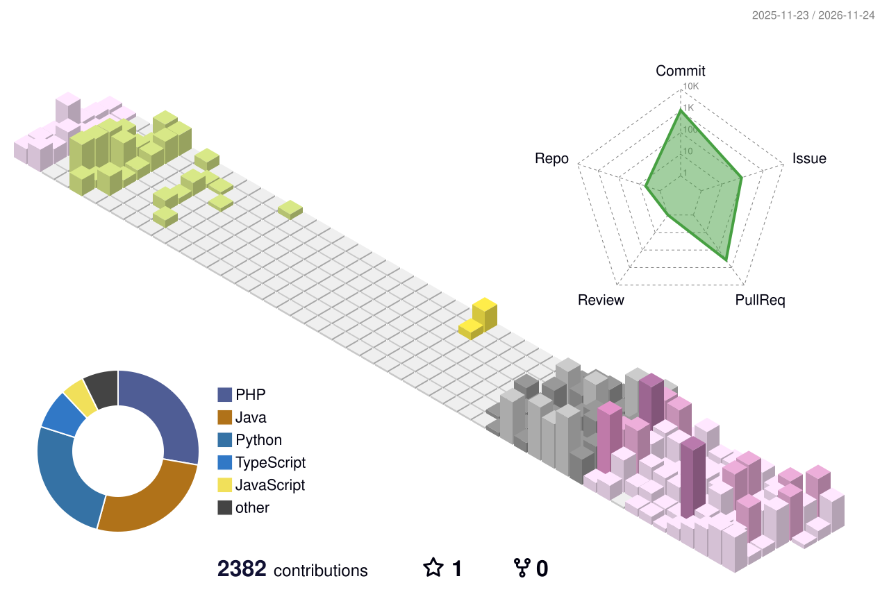

##  About Me

<table>
<tr>
<td width="50%" valign="top">

### ES
Soy **desarrolladora full stack con foco en backend**, egresada de la Tecnicatura Universitaria en Programación (UTN FRSR).

Hoy hago una pasantía sobre una plataforma de e-learning en producción con **Laravel y Vue 3**. Antes trabajé con **FastAPI y React** en una plataforma de gestión de paradas de planta del sector oil & gas, y en mis proyectos uso **Python, Java y Spring Boot**.

Me interesa el código que se puede mantener: **tests, arquitectura en capas, decisiones documentadas y CI/CD** desde el primer commit. Inglés C1.

Busco mi primer puesto full time como desarrolladora backend o full stack.

</td>
<td width="50%" valign="top">

### EN
I'm a **full stack developer with a backend focus**, graduated in Programming from UTN FRSR.

I'm currently an intern on a production e-learning platform built with **Laravel and Vue 3**. Before that I worked with **FastAPI and React** on a plant turnaround management platform for the oil & gas sector, and my own projects use **Python, Java and Spring Boot**.

I care about code that can be maintained: **tests, layered architecture, documented decisions and CI/CD** from the first commit. English at C1.

Looking for my first full time role as a backend or full stack developer.

</td>
</tr>
</table>

> [!TIP]
> **Portafolio completo con proyectos, logros técnicos y CV descargable: [meratim.github.io](https://meratim.github.io)**

##  Featured: Rinde

**[Rinde](https://github.com/MerAtim/Rinde)** es una app de finanzas personales para Argentina y LatAm. La pregunta que responde: ¿me rinde el sueldo?

Cuentas en pesos, dólares y Bitcoin; cotizaciones oficial, MEP, CCL, blue y tarjeta con fuentes de respaldo; reportes en pesos constantes ajustados por IPC; compras en cuotas, movimientos recurrentes, presupuestos con alertas e importación de CSV y del resumen PDF de Banco Macro. Se puede borrar la cuenta y exportar todos los datos propios, como pide la Ley 25.326.

Monolito modular con FastAPI y React, con la regla de dependencia entre capas verificada en cada cambio. **1207 tests de backend con 98 % de cobertura**, 377 de frontend, 42 pruebas de extremo a extremo y un dashboard que responde en 123 ms (p95) con 50.000 movimientos. Cada decisión importante está en uno de sus [34 ADR](https://github.com/MerAtim/Rinde/tree/main/docs/adr).

`Python` · `FastAPI` · `SQLAlchemy` · `PostgreSQL` · `React` · `TypeScript` · `Playwright` · `Docker` · `Cloudflare Workers` · `GitHub Actions`

*Personal finance for Argentina and LatAm. Live demo account with sample data, no sign up: it deletes itself after two hours. The free API host sleeps when idle, so the first visit can take about a minute.*

##  Currently Building

🧾 **[Facturador Fácil](https://github.com/MerAtim/facturador-facil)** es una app móvil para emitir comprobantes electrónicos de ARCA sin vueltas: ingresás el precio que cobrás y la app calcula el neto y el IVA. Nace de las limitaciones del facturador oficial.

No tiene servidor intermedio: la app habla directo con los web services de ARCA, y la clave privada se genera en el teléfono y nunca sale de ahí. Ya están cerradas la integración con ARCA, la emisión, el comprobante en PDF y la carga de clientes y productos; ahora suma varios celulares por cuenta, cada uno con su propio certificado. Monorepo con Clean Architecture, módulos nativos propios, [modelo de amenazas](https://github.com/MerAtim/facturador-facil/blob/main/docs/seguridad/modelo_de_amenazas.md) y pruebas de punta a punta en la CI, en un emulador de Android y en un iPhone simulado.

`TypeScript` · `React Native` · `Expo` · `Kotlin` · `SQLite` · `Vitest` · `Maestro` · `GitHub Actions`

*Work in progress: mobile app to issue Argentine electronic invoices (ARCA) with no backend. The private key is generated on the device and never leaves it.*

##  Featured Projects

| Project | Description | Tech |
|---------|-------------|------|
| **E-learning Platform** | Pasantía. Plataforma en producción para una academia de programación: ejercicios de código autoevaluados, gamificación, pagos y automatización de emails. Repo privado del cliente. | Laravel, Vue 3, PostgreSQL, PHPUnit, Vitest, Docker |
| [**CapyMeal**](https://github.com/CapyMeal/CapyMeal) | Diario personal de comidas, en producción y bilingüe. Login OAuth2 con Google y Microsoft, verificación en dos pasos (2FA), sesión por cookie httpOnly cross-origin, export a PDF, PWA instalable y APK de Android. Análisis de seguridad con CodeQL. [App en vivo](https://capy-meal.vercel.app) | Vue 3, Vuetify, Laravel 13, PostgreSQL, GitHub Actions, Sentry |
| [**MedConnect**](https://github.com/MerAtim/MediConnect) | Gestión de turnos e historias clínicas con roles. Los pacientes reservan sus propios turnos, con duración por especialidad y sin superposiciones. Arquitectura hexagonal con Value Objects, JWT revocable en cookie httpOnly, historia clínica cifrada AES-256-GCM y más de 260 tests. Pasó por tres auditorías de seguridad y arquitectura. | Java 25, Spring Boot 3.5, React 18, PostgreSQL, Flyway, Testcontainers, Docker |
| [**Ferretería San Francisco**](https://www.ferreteriasanfrancisco.com.ar) | Sitio corporativo en producción. Actué como Scrum Master: coordinación del equipo, testing manual y puesta en producción del dominio. | Scrum, QA Manual, HTML/CSS/JS |
| [**CapyMarket**](https://github.com/MerAtim/CapyMarket) | E-commerce con carrito, gestión de productos y pagos integrados. [App en vivo](https://capymarket.vercel.app) | JavaScript, HTML/CSS, Mercado Pago |
| [**CapyTareas**](https://github.com/MerAtim/CapyTareas) | Gestor de tareas con backend y frontend separados, contenedores y despliegue. | Java, JavaScript, Docker, Render |

##  Tech Stack

<b>Languages</b>

 

<b>Backend & Frameworks</b>

 

<b>Frontend & Mobile</b>

 

<b>Databases</b>

 

<b>Testing & Quality</b>

 

<b>DevOps & Tools</b>

 

<b>Design</b>

 

##  GitHub Stats

<picture>
  <source media="(prefers-color-scheme: dark)" srcset="https://github-readme-stats.vercel.app/api?username=MerAtim&theme=tokyonight&hide_border=true&count_private=true&show_icons=true" />
  <source media="(prefers-color-scheme: light)" srcset="https://github-readme-stats.vercel.app/api?username=MerAtim&theme=default&hide_border=true&count_private=true&show_icons=true" />
  
</picture>
<picture>
  <source media="(prefers-color-scheme: dark)" srcset="https://github-readme-stats.vercel.app/api/top-langs/?username=MerAtim&theme=tokyonight&hide_border=true&layout=compact&langs_count=8" />
  <source media="(prefers-color-scheme: light)" srcset="https://github-readme-stats.vercel.app/api/top-langs/?username=MerAtim&theme=default&hide_border=true&layout=compact&langs_count=8" />
  
</picture>

<picture>
  <source media="(prefers-color-scheme: dark)" srcset="https://streak-stats.demolab.com/?user=MerAtim&theme=tokyonight&hide_border=true&timezone=America/Argentina/Buenos_Aires" />
  <source media="(prefers-color-scheme: light)" srcset="https://streak-stats.demolab.com/?user=MerAtim&theme=default&hide_border=true&timezone=America/Argentina/Buenos_Aires" />
  
</picture>

<!-- 3D contribution calendar -->
<picture>
  <source media="(prefers-color-scheme: dark)" srcset="https://raw.githubusercontent.com/MerAtim/MerAtim/output/profile-3d-contrib/profile-night-rainbow.svg" />
  <source media="(prefers-color-scheme: light)" srcset="https://raw.githubusercontent.com/MerAtim/MerAtim/output/profile-3d-contrib/profile-south-season-animate.svg" />
  
</picture>

<!-- Pacman -->
<picture>
  <source media="(prefers-color-scheme: dark)" srcset="https://raw.githubusercontent.com/MerAtim/MerAtim/output/pacman-dark.svg" />
  <source media="(prefers-color-scheme: light)" srcset="https://raw.githubusercontent.com/MerAtim/MerAtim/output/pacman.svg" />
  
</picture>

 

<!-- Snake -->
<picture>
  <source media="(prefers-color-scheme: dark)" srcset="https://raw.githubusercontent.com/MerAtim/MerAtim/output/snake-dark.svg" />
  <source media="(prefers-color-scheme: light)" srcset="https://raw.githubusercontent.com/MerAtim/MerAtim/output/snake.svg" />
  
</picture>

 

<!-- Breakout -->
<picture>
  <source media="(prefers-color-scheme: dark)" srcset="https://raw.githubusercontent.com/MerAtim/MerAtim/output/breakout-dark.svg" />
  <source media="(prefers-color-scheme: light)" srcset="https://raw.githubusercontent.com/MerAtim/MerAtim/output/breakout.svg" />
  
</picture>

*"El código es mi herramienta, la creatividad mi motor, y el aprendizaje mi camino."*

